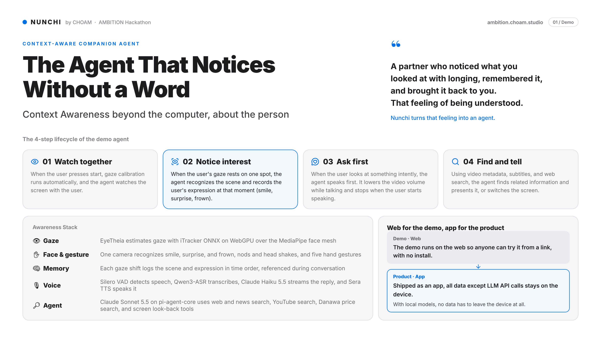
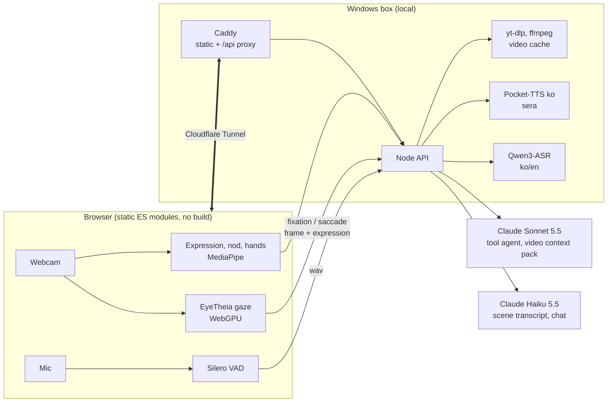
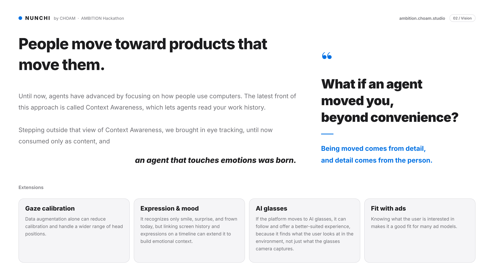

<div align="center">

# NUNCHI 눈치

### The agent that notices, even when you don't say a word.

**A context-aware companion that watches with you and picks up on what you pick up on.**

One webcam reads your gaze, your face and your hands. NUNCHI remembers what you looked at and speaks up first.

[English](README.md) | [한국어](README.ko.md)

[](https://ambition.choam.studio)
[](pitch/nunchi-en-pitch.pdf)


-111111?style=flat-square)

[**Live demo**](https://ambition.choam.studio) · [Pitch (PDF)](pitch/nunchi-en-pitch.pdf) · [How it works](#how-it-works) · [Run it](#run-it) · [Vision](#vision)

<br>

<a href="pitch/nunchi-en-pitch.pdf"></a>

<sub>Pitch p.1 (demo). Full 2-page board: <a href="pitch/nunchi-en-pitch.pdf">PDF</a>. Made by Eunho, PR #2 (Korean board: PR #1).</sub>

</div>

<br>

> A partner who remembers the thing you glanced at with a little envy, and brings it up later.
> That moment of "you actually noticed what I felt."
> **NUNCHI turns that feeling into an agent.**

*Nunchi (눈치) is the Korean art of reading the room without being told.*

## At a glance

Most agents know what you told them. NUNCHI knows what you looked at.

| | What it does |
|---|---|
| **See** | Tracks where you look on screen with a plain webcam. When your gaze rests on something, it captures the scene and works out what it is. |
| **Feel** | Records your expression (smile, surprise, frown), nods, shakes and hand gestures at that exact moment. |
| **Remember** | Scenes pile up on a timeline. Ask "what was that thing I saw five minutes ago?" and it answers. |
| **Speak first** | When it spots your interest, it asks. Say yes and it finds a related video or article and plays it. |
| **Talk** | Voice calls over the mic. Interrupt it mid-sentence. Make a fist to mute. |

Nothing to install. Open the link and try it: **https://ambition.choam.studio** (Chrome, allow webcam and mic).

## The demo, step by step

The demo agent's four-stage lifecycle.

| Stage | What happens |
|---|---|
| **01 Watch together** | Press start and gaze calibration runs on its own. The agent watches the same screen you do. |
| **02 Notice interest** | When your gaze settles, the agent recognizes what is on screen and records your expression at that moment. |
| **03 Ask first** | If you seem absorbed in something, the agent speaks up first. The video ducks while it talks and stops when you start. |
| **04 Look it up** | It uses the video's metadata, subtitles and a web search to suggest a related video or article. Accept, and it plays right away or opens in an in-app reader. |

## Awareness Stack

| Layer | Implementation |
|---|---|
| **Gaze** | iTracker ONNX on top of the MediaPipe face mesh, run by onnxruntime-web on WebGPU (WASM fallback). 9-point calibration, accuracy check, per-axis correction map, One Euro filter. |
| **Face and body** | Smile, surprise and frown from blendshapes. Head nod and shake. Five hand gestures (MediaPipe GestureRecognizer). All from one camera. |
| **Memory** | On every big gaze jump, Haiku transcribes the full frame into a timestamped record, with the video position and your expression attached. |
| **Voice** | Silero VAD detects speech, Qwen3-ASR (ko/en) transcribes, Claude Haiku 5.5 streams the reply, Korean Pocket-TTS (`sera`) speaks it. |
| **Agent** | Claude Sonnet 5.5 on pi-agent-core, with tools for web and news search, YouTube search, Danawa price search and "look at the screen again." |

## What is built

<table>
<tr>
<td width="50%" valign="top">

**Gaze tracking**
In-browser inference based on EyeTheia. Mouse (`?gaze=mouse`) and WebGazer (`?tracker=webgazer`) work as fallback inputs.

**Gaze capture**
Detects fixations (staring) and saccades (big jumps), then sends the frame plus a crop around your gaze point to the agent. The same gaze also selects buttons by dwell.

**Scene memory with a sense of time**
For every scene, Haiku records objects, people, notable details and a summary. The agent can find "the thing from five minutes ago" by time.

**Content-first agent**
A context pack is prepared per video (yt-dlp metadata, subtitles, Sonnet web research). Every offer is one specific video or article, and accepting it plays it immediately.

</td>
<td width="50%" valign="top">

**Voice calls**
A single `/api/voice/talk` round trip streams ASR, the answer and sentence-by-sentence TTS audio. First sound arrives about a second after the first sentence is ready. Barge-in and an echo filter are included.

**Body input**
Answer offers with a nod or shake. Control playback, next video and mute with hand gestures.

**Expression reactions**
Reacts with a short line to a smile, surprise or frown, and logs it into that scene's memory.

**Viewing screen**
Chzzk-style layout: danmaku over the video, a yes/no question bar on top, chat on the right. Paste a YouTube link to add your own video.

</td>
</tr>
</table>

### Hand gestures

| Gesture | Action | Keyboard stand-in |
|---|---|---|
| Thumb up / down | Yes / no | `U` / `D` |
| Open palm | Pause, play (closes the article reader if open) | `P` |
| Pointing finger | "This one" (captures where you are looking) | `I` |
| Victory | Next video (closes the reader if open) | `V` |
| Fist (hold 700 ms) | Mic off / on | `F`, mute `M` |
| Head nod / shake | Yes / no to an open question | `Y` / `N` |

When the mic is muted, the VAD stops and the agent is told to ask questions you can answer with a gesture.

## How it works



**One turn:** gaze settles on something → frame captured → Haiku transcribes the scene and logs your expression → the agent combines the video pack with the timeline and asks one short question → you nod, give a thumbs up, or say "yes" → YouTube and web search → a video plays or the article reader opens.

**Design choices**
- **What you see is the input.** You never write a prompt. Gaze, face and hands are the input, and the agent speaks first.
- **Content first.** Instead of a generic search link, it offers one specific video or article, and accepting runs it right away.
- **One round trip.** Voice bundles ASR, answer and TTS into a single stream to cut the delay before the first sound.
- **Inference in the browser.** Gaze and gestures never ship video to the server. Only captured scene frames and speech go over the wire.
- **Web for the demo, app for the product.** The web version is a zero-install demo. Shipped as an app, everything except the LLM API calls stays on the device, and with a local model nothing has to leave it at all.

## Run it

**30 seconds, no server (mock mode)**

```bash
git clone https://github.com/CHOAM-CO/CHOAM-AMBITION.git
cd CHOAM-AMBITION/web
python3 -m http.server 8123      # any static server works
# open http://localhost:8123/?mock=1&gaze=mouse
```

`?mock=1` swaps every API call for a fake response, and `?gaze=mouse` uses the mouse as your gaze. You can click through the whole flow without a webcam. The keyboard stand-ins (`Y` `N` `U` `D` `P` `I` `V` `F` `M`) work too.

**Full stack (webcam, voice, real agent)**

```bash
cd server && npm ci && npm start   # Node 22+, 127.0.0.1:8788
```

Caddy serves `web/` and proxies `/api` to the Node API (`deploy/Caddyfile`). ASR (Qwen3-ASR) listens on `127.0.0.1:8790`, and TTS runs as a worker pool in `server/tts`. The video cache needs `yt-dlp` and `ffmpeg`. Keys and settings come from `AMBITION_*` environment variables (`server/src/config.mjs`). The deployment box is described in [`deploy/README.md`](deploy/README.md).

<details>
<summary><b>URL parameters</b></summary>

| Parameter | Effect |
|---|---|
| `?mock=1` | Fake API responses, no server needed |
| `?gaze=mouse` | Use the mouse as gaze |
| `?tracker=webgazer` | WebGazer (default is EyeTheia) |
| `?calib=click` | Click calibration (default is automatic, eyes only) |
| `?model=baseline`, `?margin=px`, `?models=<url>` | EyeTheia model choice, crop margin, model location |
| `?stt=vad\|webspeech\|off` | Speech input mode |
| `?debug=1` | HUD (gaze, state, expression scores), text input, debug keys (`1` `2` `3` simulate smile, surprise, frown) |

Tune values live from the console via `window.AMBITION_CONFIG` (gaze, gestures, expressions, call).

</details>

<details>
<summary><b>API</b></summary>

| Endpoint | Purpose |
|---|---|
| `GET /api/health` | Status |
| `GET /api/videos` | Catalog |
| `POST /api/session` | Create a session |
| `POST /api/capture` | Analyze a gaze capture, question bar, carried-over offer |
| `POST /api/feedback` | Record a yes/no answer |
| `POST /api/scene`, `GET /api/scene?sessionId=`, `GET /api/scene/img/:sid/:id.jpg` | Write, read and fetch images of scene memory |
| `POST /api/voice/turn` | Text turn, NDJSON (`say` `tool` `items` `offer` `play` `ignored` `done`). `trigger: user\|idle\|followup\|accept` |
| `POST /api/voice/talk` | Audio in, one call: `asr` `answer` + `say` + `audio` stream |
| `POST /api/asr` | Speech to text |
| `POST /api/chat` | JSON chat (with offers) |
| `POST /api/summary` | Video summary and recommendations |
| `POST /api/youtube/add`, `/remove`, `/prefetch`, `GET /api/youtube/status/:id` | Add, remove and cache your own videos |
| `GET /api/pack/:youtubeId` | Video context pack |
| `GET /api/article?url=` | Article extraction (Readability + a two-sentence Haiku summary) |
| `POST /api/tts`, `POST /api/tts/stream`, `GET /api/tts/health` | Korean TTS ([`server/tts/README.md`](server/tts/README.md)) |

</details>

<details>
<summary><b>Code map</b></summary>

| Path | Role |
|---|---|
| `web/js/eyetheia.js`, `gaze.js` | Gaze estimation, calibration, accuracy check |
| `web/js/events.js`, `dwell.js`, `capture.js` | Fixation and saccade detection, dwell selection, capture. All tunables live in `CONFIG`. |
| `web/js/expression.js`, `gesture.js`, `hands.js` | Expressions, head gestures, hand gestures |
| `web/js/call.js`, `voice.js` | VAD, calls, streaming audio playback |
| `web/js/main.js`, `ui.js`, `player.js` | Screen state machine, viewing UI, player |
| `server/src/voice.mjs`, `chat.mjs` | Voice turns, tool agent |
| `server/src/scene.mjs`, `pack.mjs`, `article.mjs` | Scene memory, video context packs, article reader |
| `server/src/youtube.mjs` | Video catalog, cache, search |
| `server/tts/` | Pocket-TTS worker |

</details>

## Vision

<div align="center">
<a href="pitch/nunchi-en-pitch.pdf"></a>
</div>

<br>

People head for products that move them. Agent progress so far has focused on how people use computers, and the latest frontier is Context Awareness: letting an agent read your work history. NUNCHI adds eye tracking, which until now only fed content analytics, and the result is an agent that touches emotion.

> Emotion lives in the details, and the details come from the person.

| Expansion | Direction |
|---|---|
| **Gaze correction** | Data augmentation alone could cut calibration further and handle more positions and angles. |
| **Expression and mood** | Today it only reads smile, surprise and frown. Linking screen records and expressions over time can build up an emotional context. |
| **AI glasses** | It carries over if the platform moves to glasses. The camera can capture not just the environment but what the wearer is looking at in it. |
| **Fit with advertising** | Knowing what a user cares about fits a range of ad models. |

## Limits

- Gaze accuracy depends on the webcam, lighting and posture. The session starts with a 9-point calibration and an accuracy check, and a low score triggers a redo.
- Latest Chrome with WebGPU is recommended (WASM fallback is slower). Webcam and mic permissions are required.
- Voice and the agent need the server running (Claude API, local ASR and TTS). Without it, use `?mock=1`.
- TTS is Korean only. Expressions cover three kinds, and thresholds need per-person tuning (`CONFIG.expression`).
- Videos are YouTube videos cached by the server. Gaze capture starts working once a video is cached.

## Team

**CHOAM**: Mino, Eunho

- Pitch board (`pitch/`): Eunho
- Browser port of the gaze tracker: Eunho

## Credits and license

This repo is **Apache-2.0** ([`LICENSE`](LICENSE)). The gaze code `web/js/eyetheia.js` and the ONNX models it uses derive from [EyeTheia](https://github.com/patherstevenson/EyeTheia) (GPL-3.0) and iTracker (Krafka et al., *Eye Tracking for Everyone*), so treat them as **GPL-3.0**.

| Component | Source | License |
|---|---|---|
| Gaze estimation | [EyeTheia](https://github.com/patherstevenson/EyeTheia), iTracker, Eunho's browser port | GPL-3.0 |
| Speech recognition | Qwen3-ASR-1.7B | Apache-2.0 |
| TTS | [Pocket-TTS](https://github.com/kyutai-labs/pocket-tts) (Kyutai), Korean 100M model (seastar105) | CC BY 4.0 |
| Voice `sera` | Clone of a Supertonic 3 synthetic preset (not in this repo) | OpenRAIL-M |
| VAD | Silero VAD, `@ricky0123/vad-web` | MIT |
| Hand gestures, face landmarks | MediaPipe Tasks | Apache-2.0 |
| Fallback gaze | WebGazer | GPL-3.0 |
| Client-side inference | onnxruntime-web | MIT |
| Agent runtime | pi-ai, pi-agent-core | per package |

The pitch board (`pitch/`) was written by Eunho (Korean: PR #1, English: PR #2). This README follows its structure and wording.

<div align="center"><sub>NUNCHI by CHOAM · AMBITION Hackathon</sub></div>
