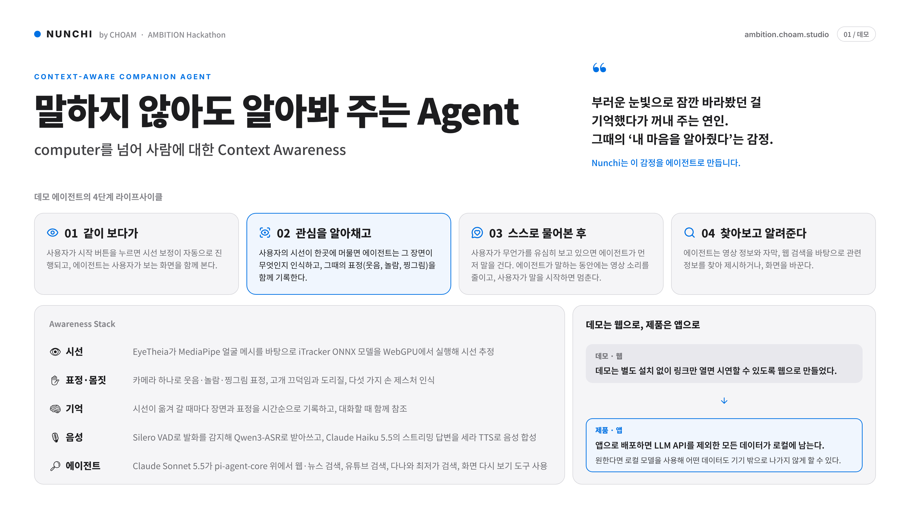
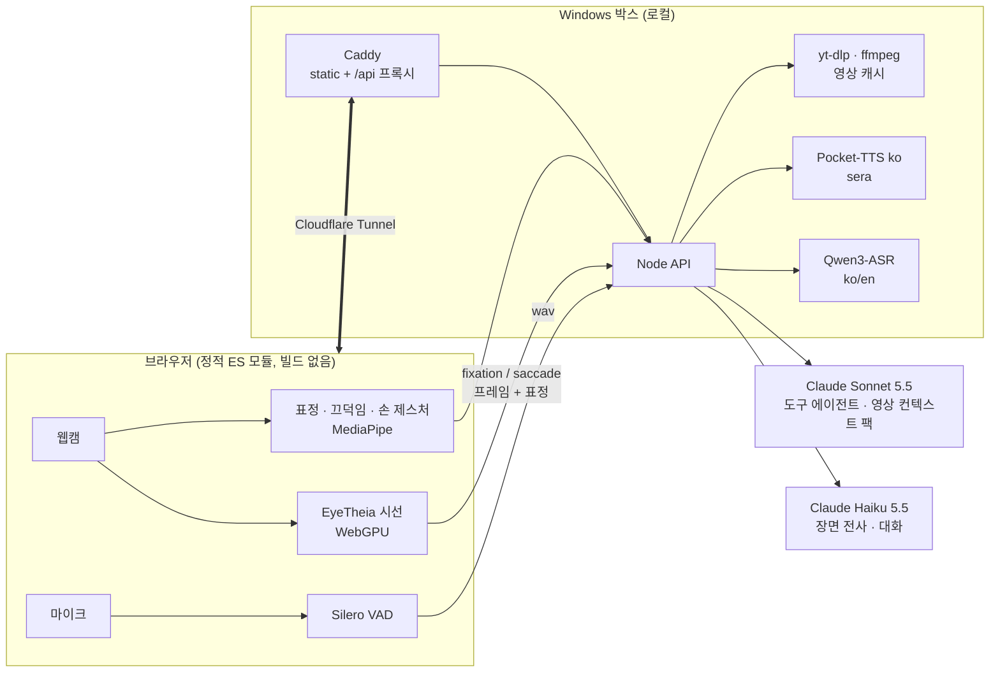
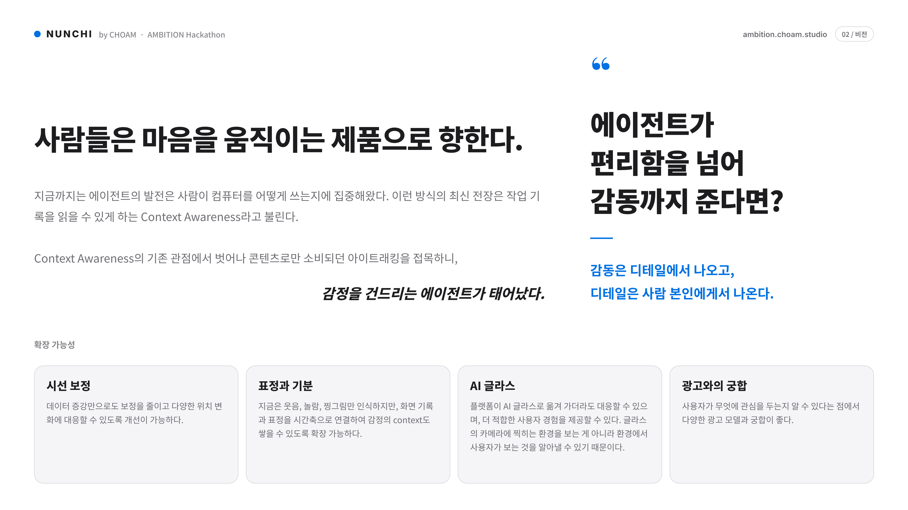

<div align="center">

# NUNCHI 눈치

### 말하지 않아도 알아봐 주는 Agent

**A context-aware companion that watches with you, and notices what you notice.**

웹캠 하나로 시선 · 표정 · 몸짓을 읽고, 본 것을 기억하고, 먼저 말을 거는 시청 동행 AI.

[](https://ambition.choam.studio)
[](pitch/nunchi-pitch.pdf)


-111111?style=flat-square)

[**Live demo**](https://ambition.choam.studio) · [Pitch (PDF)](pitch/nunchi-pitch.pdf) · [How it works](#how-it-works) · [Run it](#run-it) · [Vision](#vision)

<br>

<a href="pitch/nunchi-pitch.pdf"></a>

<sub>Pitch p.1 (demo). Full 2-page board: <a href="pitch/nunchi-pitch.pdf">PDF</a>. Made by Eunho, PR #1.</sub>

</div>

<br>

> 부러운 눈빛으로 잠깐 바라봤던 걸 기억했다가 꺼내 주는 연인.
> 그때의 "내 마음을 알아줬구나"라는 감정.
> **NUNCHI는 이 감정을 에이전트로 만듦.**

## 한눈에 보기

기존 에이전트는 **내가 시킨 것**만 앎. NUNCHI는 **내가 본 것**을 앎.

| | 하는 일 |
|---|---|
| **본다** | 웹캠 시선으로 화면의 어느 곳을 오래 보는지 추적. 한 곳에 머무르면 그 장면을 캡처하고 무엇인지 인식 |
| **느낀다** | 그 순간의 표정(웃음, 놀람, 찡그림), 끄덕임, 손동작을 함께 기록 |
| **기억한다** | 본 장면이 시간순 타임라인으로 쌓임. "5분 전에 본 거 뭐였지?"에 답함 |
| **먼저 말한다** | 관심을 알아채면 스스로 물어보고, 맞으면 관련 영상이나 기사를 찾아 바로 틀어 줌 |
| **통화한다** | 마이크로 대화. 말하는 중에 끼어들어도 됨. 손에 주먹을 쥐면 마이크 음소거 |

설치 없음. 링크만 열면 시연 가능: **https://ambition.choam.studio** (Chrome, 웹캠, 마이크 허용)

## 시연 흐름

데모 에이전트의 4단계 라이프사이클.

| 단계 | 일어나는 일 |
|---|---|
| **01 같이 보다가** | 시작 버튼을 누르면 시선 보정이 자동으로 진행. 에이전트는 사용자가 보는 화면을 같이 봄 |
| **02 관심을 알아채고** | 시선이 한곳에 머물면 그 장면이 무엇인지 인식하고, 그때의 표정을 함께 기록 |
| **03 스스로 물어본 후** | 사용자가 무언가를 유심히 보고 있으면 에이전트가 먼저 말을 건다. 말하는 동안 영상 소리는 줄고, 사용자가 말하면 멈춤 |
| **04 찾아보고 알려준다** | 영상 정보와 자막, 웹 검색을 바탕으로 관련 영상이나 기사를 제안. 수락하면 바로 재생하거나 앱 안 리더로 보여 줌 |

## Awareness Stack

| 층 | 구현 |
|---|---|
| **시선** | MediaPipe 얼굴 메시 위에서 iTracker ONNX를 onnxruntime-web WebGPU로 실행 (WASM 폴백). 9점 보정, 정확도 체크, 축별 보정 맵, One Euro 필터 |
| **표정 · 몸짓** | 카메라 하나로 웃음 · 놀람 · 찡그림 (blendshape), 고개 끄덕임 · 도리도리, 손 제스처 5종 (MediaPipe GestureRecognizer) |
| **기억** | 시선이 크게 옮겨 갈 때마다 전체 화면을 Haiku가 전사해 시간순 기록. 실제 시각과 영상 위치, 그때의 표정이 같이 붙음 |
| **음성** | Silero VAD로 발화 감지, Qwen3-ASR (ko/en)로 받아쓰기, Claude Haiku 5.5 스트리밍 답변을 한국어 Pocket-TTS(`sera`)로 합성 |
| **에이전트** | Claude Sonnet 5.5가 pi-agent-core 위에서 웹 · 뉴스 검색, 유튜브 검색, 다나와 최저가 검색, 화면 다시 보기 도구 사용 |

## 무엇이 만들어졌나

<table>
<tr>
<td width="50%" valign="top">

**시선 추적**
EyeTheia 기반 브라우저 내 추론. 마우스(`?gaze=mouse`)와 WebGazer(`?tracker=webgazer`)도 대체 입력으로 지원.

**시선 캡처**
fixation(오래 봄)과 saccade(크게 옮김)를 감지해 프레임과 시선 주변 crop을 에이전트에 전달. 같은 시선으로 버튼도 선택(dwell).

**장면 기억 + 시간 감각**
장면마다 물건 · 인물 · 특징 · 요약을 Haiku가 기록. 에이전트는 "5분 전에 본 거"를 시간으로 찾음.

**콘텐츠 우선 에이전트**
영상마다 컨텍스트 팩을 미리 생성 (yt-dlp 메타 + 자막 + Sonnet 웹 조사). 제안은 구체적인 영상 하나 또는 기사 하나이고, 수락하면 바로 재생.

</td>
<td width="50%" valign="top">

**음성 통화**
`/api/voice/talk` 한 번의 왕복으로 ASR, 답변, 문장 단위 TTS 오디오까지 스트리밍. 첫 문장이 끝나면 약 1초 안에 첫 소리. 말 끊기(barge-in)와 에코 필터 지원.

**몸짓 입력**
끄덕임/도리도리로 제안에 답하고, 손 제스처로 재생 · 다음 영상 · 음소거 제어.

**표정 반응**
웃음 · 놀람 · 찡그림에 한마디 반응하고 그 장면 기억에 기록.

**시청 화면**
Chzzk 스타일 레이아웃: 영상 위 danmaku, 상단 yes/no 질문 줄, 오른쪽 채팅. YouTube 주소를 붙여 넣으면 내 영상도 추가.

</td>
</tr>
</table>

### 손동작

| 제스처 | 동작 | 키보드 대용 |
|---|---|---|
| 엄지 위 / 아래 | 응 / 아니 | `U` / `D` |
| 손바닥 | 멈춤, 재생 (기사 리더가 열려 있으면 닫기) | `P` |
| 검지 | 이거 (지금 시선 지점 캡처) | `I` |
| 브이 | 다음 영상 (리더가 열려 있으면 닫기) | `V` |
| 주먹 (700ms 유지) | 마이크 끔 / 켬 | `F`, 음소거 `M` |
| 고개 끄덕임 / 도리도리 | 열린 질문에 응 / 아니 | `Y` / `N` |

마이크가 꺼지면 VAD가 멈추고, 에이전트는 말 대신 제스처로 답할 수 있게 물음.

## How it works



**한 턴의 흐름**: 시선이 한곳에 머묾 → 프레임 캡처 → Haiku가 장면 전사 + 표정 기록 → 에이전트 컨텍스트(영상 팩 + 시간순 장면 기억)에 합쳐 질문 한 줄 → 사용자가 끄덕임, 엄지, 또는 목소리 "응" → 유튜브/웹 검색 → 영상 재생 또는 기사 리더.

**설계 선택**
- **본 것이 곧 입력.** 사용자는 프롬프트를 쓰지 않음. 시선, 표정, 몸짓이 입력이고 에이전트가 먼저 말을 검.
- **콘텐츠 우선.** 일반 검색 링크 대신 구체적인 영상이나 기사 하나를 제안하고 수락하면 바로 실행.
- **한 번의 왕복.** 음성은 ASR, 답변, TTS를 한 스트림으로 묶어 첫 소리까지의 지연을 줄임.
- **브라우저에서 추론.** 시선과 제스처는 서버로 영상을 보내지 않고 브라우저 안에서 처리. 서버로 가는 것은 캡처된 장면 프레임과 음성 발화.
- **데모는 웹으로, 제품은 앱으로.** 웹은 링크만 열면 되는 시연용. 앱으로 배포하면 LLM API를 제외한 모든 데이터가 로컬에 남고, 로컬 모델을 쓰면 어떤 데이터도 기기 밖으로 나가지 않게 할 수 있음.

## Run it

**30초: 서버 없이 UI만 보기 (mock)**

```bash
git clone https://github.com/CHOAM-CO/CHOAM-AMBITION.git
cd CHOAM-AMBITION/web
python3 -m http.server 8123      # 아무 정적 서버면 됨
# http://localhost:8123/?mock=1&gaze=mouse
```

`?mock=1`은 API를 가짜 응답으로 대체하고 `?gaze=mouse`는 마우스를 시선으로 씀. 웹캠 없이 흐름 전체를 눌러 볼 수 있음. 키보드 대용(`Y` `N` `U` `D` `P` `I` `V` `F` `M`)도 그대로 동작.

**풀 스택 (웹캠, 음성, 실제 에이전트)**

```bash
cd server && npm ci && npm start   # Node 22+, 127.0.0.1:8788
```

Caddy가 `web/`을 정적 서빙하고 `/api`를 Node API로 프록시 (`deploy/Caddyfile`). ASR(Qwen3-ASR)은 `127.0.0.1:8790`, TTS는 `server/tts` 워커 풀. 영상 캐시에 `yt-dlp`와 `ffmpeg` 필요. API 키와 설정은 `AMBITION_*` 환경변수 (`server/src/config.mjs`). 배포 박스 구성은 [`deploy/README.md`](deploy/README.md).

<details>
<summary><b>URL 파라미터</b></summary>

| 파라미터 | 효과 |
|---|---|
| `?mock=1` | API 없이 가짜 응답 |
| `?gaze=mouse` | 마우스를 시선으로 사용 |
| `?tracker=webgazer` | WebGazer (기본은 EyeTheia) |
| `?calib=click` | 클릭 보정 (기본은 눈만으로 자동 보정) |
| `?model=baseline`, `?margin=px`, `?models=<url>` | EyeTheia 모델 선택, crop 여백, 모델 위치 |
| `?stt=vad\|webspeech\|off` | 음성 입력 방식 |
| `?debug=1` | HUD (시선, 상태, 표정 점수), 입력창, 디버그 키 (`1` `2` `3` = 웃음 · 놀람 · 찡그림 시뮬레이션) |

런타임 튜닝은 콘솔의 `window.AMBITION_CONFIG` (시선, 제스처, 표정, 통화 값).

</details>

<details>
<summary><b>API</b></summary>

| 엔드포인트 | 용도 |
|---|---|
| `GET /api/health` | 상태 |
| `GET /api/videos` | 카탈로그 |
| `POST /api/session` | 세션 만들기 |
| `POST /api/capture` | 시선 캡처 분석, 질문 줄, 이월 offer |
| `POST /api/feedback` | 질문에 대한 yes/no 기록 |
| `POST /api/scene`, `GET /api/scene?sessionId=`, `GET /api/scene/img/:sid/:id.jpg` | 장면 기억 기록 / 조회 / 이미지 |
| `POST /api/voice/turn` | 텍스트 입력 턴, NDJSON (`say` `tool` `items` `offer` `play` `ignored` `done`). `trigger: user\|idle\|followup\|accept` |
| `POST /api/voice/talk` | 오디오 입력 한 번에: `asr` `answer` + `say` + `audio` 스트림 |
| `POST /api/asr` | 음성 → 텍스트 |
| `POST /api/chat` | JSON 채팅 (offer 포함) |
| `POST /api/summary` | 영상 요약과 추천 |
| `POST /api/youtube/add`, `/remove`, `/prefetch`, `GET /api/youtube/status/:id` | 내 영상 추가 / 삭제 / 캐시 |
| `GET /api/pack/:youtubeId` | 영상 컨텍스트 팩 |
| `GET /api/article?url=` | 기사 본문 추출 (Readability + Haiku 2문장 요약) |
| `POST /api/tts`, `POST /api/tts/stream`, `GET /api/tts/health` | 한국어 TTS ([`server/tts/README.md`](server/tts/README.md)) |

</details>

<details>
<summary><b>코드 지도</b></summary>

| 경로 | 역할 |
|---|---|
| `web/js/eyetheia.js`, `gaze.js` | 시선 추정, 보정, 정확도 체크 |
| `web/js/events.js`, `dwell.js`, `capture.js` | fixation / saccade 감지, dwell 선택, 캡처. 모든 튜닝 값은 `CONFIG` |
| `web/js/expression.js`, `gesture.js`, `hands.js` | 표정, 고개 제스처, 손 제스처 |
| `web/js/call.js`, `voice.js` | VAD, 통화, 스트리밍 오디오 재생 |
| `web/js/main.js`, `ui.js`, `player.js` | 화면 상태 머신, 시청 UI, 플레이어 |
| `server/src/voice.mjs`, `chat.mjs` | 음성 턴, 도구 에이전트 |
| `server/src/scene.mjs`, `pack.mjs`, `article.mjs` | 장면 기억, 영상 컨텍스트 팩, 기사 리더 |
| `server/src/youtube.mjs` | 영상 카탈로그, 캐시, 검색 |
| `server/tts/` | Pocket-TTS 워커 |

</details>

## Vision

<div align="center">
<a href="pitch/nunchi-pitch.pdf"></a>
</div>

<br>

지금까지 에이전트는 사람이 컴퓨터를 어떻게 쓰는지에 집중해 왔고, 최신 전장은 작업 기록을 읽는 Context Awareness. NUNCHI는 여기에 콘텐츠로만 소비되던 **아이트래킹**을 접목해 감정을 건드리는 에이전트를 만듦.

> 감동은 디테일에서 나오고, 디테일은 사람 본인에게서 나온다.

| 확장 | 방향 |
|---|---|
| **시선 보정** | 데이터 증강만으로도 보정을 줄이고 다양한 위치 변화에 대응하도록 개선 가능 |
| **표정과 기분** | 지금은 웃음 · 놀람 · 찡그림만 인식. 화면 기록과 표정을 시간축으로 연결해 감정의 context를 쌓도록 확장 가능 |
| **AI 글라스** | 플랫폼이 글라스로 옮겨 가도 대응 가능. 카메라에 찍히는 환경만이 아니라 환경에서 사용자가 보는 것을 알아낼 수 있음 |
| **광고와의 궁합** | 사용자가 무엇에 관심을 두는지 알 수 있어 다양한 광고 모델과 궁합이 좋음 |

## Limits

- 시선 정확도는 웹캠, 조명, 자세에 영향받음. 시작 때 9점 보정과 정확도 체크를 거치며, 점수가 낮으면 다시 맞춤.
- WebGPU가 되는 최신 Chrome 권장 (없으면 WASM 폴백, 느림). 웹캠과 마이크 권한 필요.
- 음성과 에이전트는 서버(Claude API, 로컬 ASR/TTS)가 떠 있어야 동작. 서버 없이는 `?mock=1`.
- TTS는 한국어 전용. 표정은 3종, 임계값은 사람마다 튜닝이 필요 (`CONFIG.expression`).
- 영상은 서버가 캐시한 YouTube 영상이 대상. 시선 캡처는 캐시된 뒤부터 동작.

## Team

**CHOAM**: Mino, Eunho

- 피치 보드 (`pitch/`): Eunho
- 시선 추적 브라우저 포트: Eunho

## 크레딧 / 라이선스

이 repo는 **Apache-2.0** ([`LICENSE`](LICENSE)). 단 시선 추적 코드 `web/js/eyetheia.js`와 거기서 쓰는 ONNX 모델은 GPL-3.0인 [EyeTheia](https://github.com/patherstevenson/EyeTheia)와 iTracker (Krafka et al., *Eye Tracking for Everyone*)에서 파생됐으므로 **GPL-3.0으로 취급**.

| 구성 | 출처 | 라이선스 |
|---|---|---|
| 시선 추정 | [EyeTheia](https://github.com/patherstevenson/EyeTheia), iTracker, Eunho의 브라우저 포트 | GPL-3.0 |
| 음성 인식 | Qwen3-ASR-1.7B | Apache-2.0 |
| TTS | [Pocket-TTS](https://github.com/kyutai-labs/pocket-tts) (Kyutai), 한국어 100M 모델 (seastar105) | CC BY 4.0 |
| 목소리 `sera` | Supertonic 3 합성 프리셋 클론 (repo 미포함) | OpenRAIL-M |
| VAD | Silero VAD, `@ricky0123/vad-web` | MIT |
| 손동작, 얼굴 랜드마크 | MediaPipe Tasks | Apache-2.0 |
| 보조 시선 | WebGazer | GPL-3.0 |
| 클라이언트 추론 | onnxruntime-web | MIT |
| 에이전트 런타임 | pi-ai, pi-agent-core | 각 패키지 라이선스 |

피치 보드(`pitch/`)는 PR #1 (`pitch` 브랜치)로 Eunho가 작성. 이 README의 구성과 문구는 그 보드를 따름.

<div align="center"><sub>NUNCHI by CHOAM · AMBITION Hackathon</sub></div>
